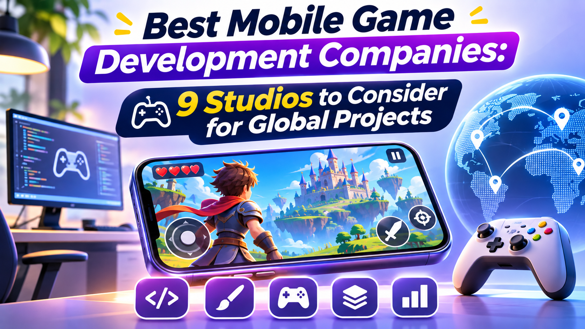

# Best Mobile Game Development Companies: 9 Studios to Consider for Global Projects

The mobile gaming industry continues to create opportunities for startups, established businesses, entertainment brands, and independent creators. From casual puzzle experiences to competitive multiplayer adventures, successful games combine creative concepts, intuitive controls, engaging visuals, and reliable technology. Choosing the right development partner is one of the most important decisions when turning an idea into a playable product.

However, finding a suitable studio is not simply about choosing the company with the biggest portfolio. Businesses need developers who understand their preferred game genre, target audience, technical requirements, budget, and long-term goals. A team experienced in Android and iOS production may be ideal for one project, while another may require multiplayer engineering, cross-platform development, game art, or ongoing live operations.

This guide explores nine mobile game development companies and studios worth considering for projects targeting the USA, UK, Canada, France, Australia, Germany, and other international markets. It compares their strengths, services, pricing approach, advantages, and limitations to help businesses create a practical shortlist before requesting proposals.

## Comparison Table: Best Mobile Game Development Companies

| Company | Location | Best For | Main Capabilities |
|---|---|---|---|
| Zco Corporation | USA | Full-cycle mobile game production | iOS, Android, 2D/3D, AR/VR, porting |
| Snowed In Studios | Canada | Co-development and technical production | Full-game production, optimization, porting |
| Pocket Sized Hands | UK | Technical co-development and multiplayer | Unity, Unreal, optimization, live support |
| Access Studio | France | Mobile-first game concepts | iOS, Android, game design and publishing |
| ABO Games | Germany | Full-cycle and work-for-hire projects | Unity, Unreal, mobile, prototyping |
| Mighty Kingdom | Australia | Established game production and partnerships | Mobile games, licensed IP, original games |
| Juego Studios | Global services | Full-cycle development and LiveOps | Unity, mobile, multiplayer, game art |
| iLogos Game Studios | International | Production support and live operations | Full-cycle development, porting, art, QA |
| Starloop Studios | Spain / Global | Outsourced mobile game development | iOS, Android, Unity, 2D/3D |

*This is an editorial shortlist, not a certified ranking. Company locations and publicly described capabilities are based on available company information. Pricing is generally project-specific, so request a written quotation.*

### 🎮 [Discover Leading Mobile Game Development Studios →](https://www.yttags.com/best-mobile-game-development-companies/)

## 1. Zco Corporation

**Location:** Nashua, New Hampshire, USA

**Best For:** Businesses looking for a full-service development partner for custom mobile games.

### Detailed Overview

Zco Corporation is an established software and mobile application development company with a dedicated mobile game development offering. Its services cover the journey from early planning and creative direction to programming, testing, and release preparation.

The company works on games for iPhone, iPad, and Android devices. Its publicly described capabilities include cross-platform game development, 2D and 3D art production, augmented and virtual reality experiences, and game porting. This makes it a potential option for businesses that want more than a basic mobile game prototype.

Zco's portfolio includes projects such as AMP Rider, Advantage4Kids, and Coop Squad. These examples demonstrate experience with different interactive formats, including entertainment, education, and augmented reality.

For businesses targeting North America, a US-based development partner may also make communication and project coordination easier, depending on team availability and working arrangements.

### Key Features

- iOS and Android game development.
- Cross-platform development.
- Custom 2D and 3D game art.
- AR and VR development capabilities.
- Game porting and optimization.
- Quality assurance and launch assistance.
- Post-launch maintenance and updates.

### Pricing

Zco does not publish one universal price for every mobile game project. Costs depend on game complexity, platforms, artwork, technical integrations, team requirements, and delivery schedule. Request a project estimate after sharing your requirements.

### Pros

- Dedicated mobile game development services.
- Experience across different interactive project types.
- Support for art, programming, and testing.
- Cross-platform development capabilities.
- US-based company for North American clients.

### Cons

- Custom pricing makes early budget comparison difficult.
- Complex projects require detailed planning.
- Final costs depend on the agreed development scope.

### Our Review

Zco Corporation is worth considering when a business wants a development partner capable of handling multiple parts of a mobile game project. Its combination of game development, art, AR/VR, and porting services makes it relevant to companies planning more than a simple casual title.

### 📢 [Explore the Best Digital Marketing Companies →](https://www.yttags.com/digital-marketing-companies/)

## 2. Snowed In Studios

**Location:** Ottawa, Canada

**Best For:** Studios and publishers requiring co-development, porting, or technical production support.

### Detailed Overview

Snowed In Studios is a Canadian game development studio that works with independent developers and larger game companies. Its services cover co-development, complete game production, engineering, optimization, and cross-platform deployment.

One of its notable strengths is the range of technical support it describes. Rather than focusing only on creating new gameplay, the studio can assist with existing projects that need additional engineering capacity, performance improvements, tools, or platform-specific development.

This can be valuable for a business that already has a working game but needs help preparing it for additional devices or improving its technical foundation. Its experience across mobile, PC, web, and major console platforms also makes it relevant to projects with broader distribution plans.

For Canadian businesses, Snowed In Studios offers a local studio option. International publishers may also consider it for selected production or co-development requirements.

### Key Features

- Full-game and application production.
- Co-development support.
- Cross-platform deployment.
- Engine and tools development.
- Art direction and animation.
- Optimization and debugging.
- UI/UX production and technical support.

### Pricing

Snowed In Studios does not provide a universal public rate for all engagements. Pricing will depend on the size of the development team, project duration, technical complexity, and whether the requirement involves complete production or specialist support.

### Pros

- Canadian game development studio.
- Works with indie and AAA clients.
- Offers both full production and co-development.
- Technical optimization and porting capabilities.
- Useful for extending an existing production team.

### Cons

- A detailed project brief is needed for an accurate estimate.
- Some services may be more suitable for established studios than first-time founders.
- The right engagement model depends on team availability.

### Our Review

Snowed In Studios is a strong candidate for businesses that need experienced technical support rather than simply outsourcing an entire game from beginning to end. Its co-development and engineering capabilities are particularly relevant to publishers and studios working on larger production schedules.

### 💻 [Find Top .NET Development Companies →](https://www.yttags.com/best-10-net-development-companies/)

## 3. Pocket Sized Hands

**Location:** Dundee, Scotland, UK

**Best For:** Game companies seeking co-development, optimization, porting, and multiplayer expertise.

### Detailed Overview

Pocket Sized Hands is a UK-based game development studio focused on helping ambitious game projects move forward through specialist production support. Its services include co-development, porting, technical production, optimization, multiplayer development, and VR development.

The studio's technology capabilities include Unity, Unreal Engine, Godot, and custom engines. This range can be useful for projects that need engine-specific engineering or additional technical resources without rebuilding the entire production team.

For mobile game businesses, optimization and multiplayer systems can be especially important. A game must perform reliably across different devices, network conditions, and screen sizes. A development partner with relevant engineering experience can help address these requirements during production.

Pocket Sized Hands is also an option for existing game teams that need assistance with a specific technical challenge rather than a complete new game.

### Key Features

- Game co-development.
- Mobile platform support.
- Unity, Unreal, and Godot expertise.
- Porting and performance optimization.
- Multiplayer development.
- Technical production.
- VR development.

### Pricing

The studio does not provide a single fixed public price for all services. Request a quotation based on the required specialists, project stage, engine, and expected delivery schedule.

### Pros

- UK-based studio.
- Multiple game engine capabilities.
- Specialist technical services.
- Co-development and porting support.
- Relevant for multiplayer and optimization work.

### Cons

- Not every project requires its specialist technical focus.
- Pricing depends on the engagement scope.
- Clients should confirm mobile-specific experience for their chosen genre.

### Our Review

Pocket Sized Hands is worth shortlisting when a project needs technical depth, particularly around multiplayer, optimization, or porting. It may be more suitable for publishers and existing development teams than founders seeking a simple, low-cost first prototype.

### 🌐 [Choose the Right Website Development Partner →](https://www.yttags.com/best-website-development-partner-companies/)

## 4. Access Studio

**Location:** Paris, France

**Best For:** Mobile-first game concepts for iOS and Android.

### Detailed Overview

Access Studio is an independent French studio focused on designing and developing mobile video games. Its mobile-first positioning makes it relevant to businesses and creators whose primary audience will play through smartphones and tablets.

A mobile-focused production approach is important because smartphone games have different design requirements from traditional PC and console titles. Touch controls, short play sessions, interface clarity, screen variations, and device performance all influence the player experience.

An independent studio can also be an interesting option for clients who prefer a smaller creative team and direct communication. Before beginning a project, businesses should discuss the studio's availability, production capacity, publishing arrangements, and the exact responsibilities it can undertake.

### Key Features

- iOS game development.
- Android game development.
- Mobile-first game design.
- Smartphone and tablet experiences.
- Independent studio structure.
- Game creation and publishing experience.

### Pricing

Access Studio does not publish a standard development package for every project. Pricing should be discussed directly according to game design, platform requirements, production scope, and publishing arrangements.

### Pros

- Based in France.
- Clear mobile-first focus.
- iOS and Android specialization.
- Independent creative studio approach.
- Relevant to mobile-specific game concepts.

### Cons

- Public information about large-scale outsourcing capacity is limited.
- Businesses should confirm the team's size and availability.
- Project pricing needs direct discussion.

### Our Review

Access Studio may suit businesses interested in a focused mobile game concept and a direct relationship with an independent French studio. It is sensible to begin with a detailed discussion of the proposed game, expected production responsibilities, and the studio's recent mobile portfolio.

### 🏡 [Explore Property Listing App Development Experts →](https://www.yttags.com/top-9-property-listing-app-development-companies/)

## 5. ABO Games

**Location:** Leipzig, Germany

**Best For:** Businesses seeking full-cycle development, prototyping, or work-for-hire production.

### Detailed Overview

ABO Games is a German development studio that builds games and interactive digital products. It describes its working model as full-cycle production, co-development, and work-for-hire services for publishers, studios, and businesses.

Its publicly listed capabilities include mobile game development for iOS and Android, Unity and Unreal Engine production, concept development, prototyping, and porting. The studio also describes milestone-based project delivery, which can help clients review playable progress during production.

Prototyping is especially useful when a game idea has not yet been fully validated. Rather than committing the entire budget immediately, a business can first test the core gameplay, visual direction, and technical feasibility through a smaller playable version.

For companies targeting Germany and other European markets, a studio that works in both English and German may be helpful for project communication.

### Key Features

- Full-cycle game development.
- iOS and Android production.
- Unity and Unreal Engine.
- Game concept and prototype development.
- Work-for-hire and co-development.
- Porting and release support.
- Milestone-based production options.

### Pricing

ABO Games describes project-based billing options, including fixed-price, milestone, and day-rate arrangements. The final quotation depends on the game design, development requirements, production schedule, and agreed deliverables.

### Pros

- Germany-based development studio.
- Offers work-for-hire and co-development.
- Supports mobile platforms.
- Prototype and concept development.
- English and German working languages.

### Cons

- Public portfolio information should be reviewed against your specific game genre.
- Pricing requires a project discussion.
- Businesses should confirm post-launch support requirements before signing.

### Our Review

ABO Games is a relevant option for businesses that want a structured production process with clear milestones. Its combination of prototyping and full-cycle development can help reduce uncertainty before a larger mobile game investment.

### 🤖 [Find the Best AI Agent Development Companies →](https://www.yttags.com/best-ai-agent-development-company/)

## 6. Mighty Kingdom

**Location:** Adelaide, Australia

**Best For:** Game projects involving established entertainment brands, original concepts, and experienced production teams.

### Detailed Overview

Mighty Kingdom is an Australian game developer with a portfolio that includes mobile games and collaborations with well-known entertainment and consumer brands. The company reports having released more than 50 games, with over 50 million downloads across its portfolio.

Its publicly highlighted work includes projects connected with LEGO, Shopkins, Gabby's Dollhouse, and other recognizable properties. This background makes the company particularly interesting for businesses exploring licensed entertainment experiences, branded games, and family-oriented mobile products.

Mighty Kingdom's experience also illustrates why choosing a developer with the right genre and audience background matters. A children's game, a branded casual title, and a competitive multiplayer game each require different creative and technical decisions.

Businesses should contact the studio to confirm whether it is accepting external development or partnership projects that match their requirements. Its role may differ depending on the opportunity.

### Key Features

- Mobile game production experience.
- Original game development.
- Work involving established entertainment brands.
- Family and casual gaming experience.
- International brand collaborations.
- Experience across different game concepts.

### Pricing

Mighty Kingdom does not publish a standard public price for all potential partnerships. Project costs and commercial terms need to be discussed directly and will depend on the production scope and partnership model.

### Pros

- Australian game development presence.
- Portfolio includes recognizable entertainment properties.
- Experience with mobile games.
- Useful reference for branded and family-focused projects.
- International collaboration history.

### Cons

- Not necessarily available for every work-for-hire request.
- Commercial partnership terms may vary.
- Project suitability should be confirmed before preparing a full proposal.

### Our Review

Mighty Kingdom is an interesting company to investigate when the project involves branded entertainment, family audiences, or a recognizable intellectual property. It should be approached as a potential development or business partner, with its current availability and engagement model confirmed directly.

### 🛒 [Discover Top B2B Marketplace Development Companies →](https://www.yttags.com/best-b2b-marketplace-development-companies/)

## 7. Juego Studios

**Location:** Bengaluru, India; international client services

**Best For:** Businesses looking for full-cycle game production, co-development, and ongoing game support.

### Detailed Overview

Juego Studios is a game development company offering services across mobile, PC, console, and immersive platforms. Its portfolio includes mobile projects developed with Unity, as well as strategy, puzzle, sports, and multiplayer experiences.

The company describes services covering game design, development, art production, live operations, and other production requirements. This broad offering can be useful for clients who want one development partner to coordinate several stages of a game project.

Its public portfolio includes titles such as Adventure Quest Battle Gems, Raids of Glory, Pro Feel Golf, Medals of War, and other projects. These examples give prospective clients an opportunity to compare the studio's work with their own intended game genre.

For international businesses, a distributed development arrangement can offer access to a wider production team. However, clients should clarify communication schedules, project management responsibilities, ownership rights, and delivery milestones before starting.

### Key Features

- Full-cycle game development.
- iOS and Android game production.
- Unity game development.
- Game art and animation.
- Multiplayer and cross-platform experience.
- LiveOps and post-launch support.
- Co-development services.

### Pricing

Juego Studios does not offer one fixed price for every game. Its quotation will depend on the project scope, team size, platform requirements, art direction, integrations, and expected production timeline.

### Pros

- Broad game development service range.
- Public portfolio of mobile and cross-platform projects.
- Full-cycle and co-development options.
- Game art and LiveOps capabilities.
- International client experience.

### Cons

- A large service portfolio means clients should identify the exact team needed.
- Pricing requires a custom estimate.
- Project management and communication expectations should be agreed in advance.

### Our Review

Juego Studios is a useful option for businesses that want a broad development partner with experience across several game genres. Its portfolio and full-cycle services make it worth considering for projects that require both creative production and technical execution.

## 8. iLogos Game Studios

**Location:** International game production services

**Best For:** Publishers and studios requiring game production, porting, art, QA, or live operations.

### Detailed Overview

iLogos Game Studios provides production services for game companies, including full-cycle development, game art, porting, and live operations. Its service model is particularly relevant to businesses that already have a game concept or existing title but need additional production capacity.

A development project does not always require one company to build everything from the beginning. Sometimes a publisher needs additional artists, a specialist engineering team, quality assurance, or support with a new platform release. A production partner can help fill those gaps.

iLogos describes support across the game lifecycle, from concept and production to post-release updates. This can be valuable for mobile games that need regular content, events, technical maintenance, and performance improvements after launch.

Businesses should request relevant mobile case studies and confirm which parts of the project the company would handle directly.

### Key Features

- Full-cycle game development.
- Game art production.
- Game porting.
- Quality assurance support.
- Live operations.
- Post-release content and technical support.
- Production support for game companies.

### Pricing

Pricing depends on the service selected, required team composition, production volume, and project duration. Request a tailored estimate for a complete game or a specific production requirement.

### Pros

- Multiple game production services.
- Useful for publishers and existing studios.
- Porting and live operations capabilities.
- Can support different stages of production.
- Suitable for specialist outsourcing requirements.

### Cons

- Not every service will be necessary for a new startup.
- Clients should confirm mobile-specific case studies.
- Project costs vary with team size and service scope.

### Our Review

iLogos is worth considering when a business needs more than basic programming support. Its range of production services can be relevant to publishers and established studios that want to expand capacity, improve an existing game, or manage ongoing development requirements.

## 9. Starloop Studios

**Location:** Lleida, Spain; international services

**Best For:** Outsourced mobile game development and cross-platform production.

### Detailed Overview

Starloop Studios is a game development studio that offers mobile game production services for iOS and Android. Its publicly described work covers the development process from early concepts and game art through programming, testing, and launch preparation.

The company also lists Unity development, cross-platform production, 2D and 3D game development, game porting, and quality assurance among its capabilities. This makes it relevant to businesses that want an external team to support a mobile game from an early stage.

Its portfolio includes games such as Fieldrunners Attack!, Momonga, Mutant Madness, and Jelly Copter. These examples cover different gameplay styles, giving prospective clients a starting point for evaluating its creative experience.

Starloop is part of Magic Media, an international group with services across the games and entertainment industries. Clients should still confirm the specific team, production responsibilities, and delivery arrangements proposed for their project.

### Key Features

- iOS and Android game development.
- Unity development.
- Cross-platform production.
- 2D and 3D game development.
- Game art and animation.
- Game prototyping and QA.
- Porting and co-development.

### Pricing

Starloop Studios does not publish a universal project price. Costs depend on game genre, development complexity, required specialists, production schedule, and the services included in the agreement.

### Pros

- Dedicated mobile game development services.
- Experience with multiple game genres.
- Unity and cross-platform capabilities.
- Art, QA, and porting services.
- International production group.

### Cons

- Custom project pricing.
- Clients should verify the proposed team and portfolio fit.
- Large projects require clearly defined milestones and responsibilities.

### Our Review

Starloop Studios is a relevant option for businesses seeking outsourced mobile game development with support for multiple production stages. It may be especially useful when a project requires a combination of gameplay development, art production, and platform support.

## How to Choose the Right Mobile Game Development Company

Choosing a development company should begin with the game itself, not the agency's marketing claims. Before contacting studios, define the genre, target platforms, intended audience, core gameplay loop, visual style, and essential features.

A casual puzzle game may need strong level design, accessible controls, and a well-planned progression system. A multiplayer action game may require networking, matchmaking, backend infrastructure, anti-cheat measures, and ongoing server support. The company you select should have experience relevant to those requirements.

Review each studio's portfolio carefully. Look for playable examples, published titles, and case studies that demonstrate what the team actually delivered. Ask whether the work was completed in-house, through co-development, or as a specialist service.

You should also compare project management methods. A reliable partner should explain how it handles milestones, testing, feedback, source-code access, intellectual property, and post-launch responsibilities. Request a written proposal that separates development, third-party services, maintenance, and optional features.

For broader digital marketing research, businesses can also review this [Reddit marketing agencies resource](https://sites.google.com/view/best-reddit-marketing-agencies/). Marketing support is a separate requirement from game production, but it may become relevant when planning a game's launch and community-building strategy.

## Mobile Game Development Cost: What Should Businesses Budget?

Mobile game development costs vary significantly. A simple 2D game with a limited number of levels is very different from a 3D multiplayer experience with custom characters, online services, and regular content updates.

The main cost factors include:

- **Game complexity:** More mechanics, levels, characters, and systems increase production effort.
- **Platform requirements:** Building for iOS, Android, or both affects development and testing.
- **Art and animation:** Custom 2D and 3D assets require design, modeling, animation, and optimization.
- **Backend infrastructure:** Multiplayer, accounts, leaderboards, cloud saves, and live services add technical requirements.
- **Testing:** Device compatibility, performance, security, and regression testing need dedicated time.
- **Post-launch support:** Updates, events, bug fixes, and new content require an ongoing budget.

Instead of comparing companies only by their starting prices, ask for a breakdown of the work included in each proposal. A low initial quote may exclude important services such as QA, store submission, analytics, or post-launch maintenance.

A practical approach is to divide the project into discovery, prototype, production, testing, and launch milestones. This makes it easier to evaluate progress and manage spending.

## Mobile Game Development Trends for International Markets

A game intended for several countries needs more than a successful core concept. Businesses targeting the USA, UK, Canada, France, Australia, and Germany should consider language, cultural preferences, payment options, privacy requirements, and device performance from the beginning.

Localization is more than translating menus. It can involve adapting dialogue, humour, tutorials, dates, currencies, promotional content, and in-game events. French-language support, for example, may be relevant when targeting French-speaking audiences in France and Canada. German localization can improve accessibility for players in Germany and other German-speaking markets.

Cross-platform development is another important consideration. Many businesses want a consistent experience across iPhones and Android devices, while some may later explore PC or web versions. The right technical architecture can make future expansion easier, although every additional platform requires testing and maintenance.

Live operations are also important for games designed to retain players over time. Seasonal events, new levels, limited-time challenges, and balanced progression can give players reasons to return. These features should be planned as part of the business model rather than added without a clear strategy.

Creators who need supporting visual assets may explore this [AI photo editor resource](https://github.com/best-AI-Photo-Editor) as part of their wider creative research. A game's final art direction should still be managed by qualified designers who can maintain a consistent visual identity.

## Why Quality Assurance and Content Security Matter in Mobile Games

A visually attractive game can still disappoint players if it crashes, loads slowly, loses progress, or behaves differently across devices. Quality assurance should therefore be part of the production process from the beginning rather than a final check immediately before release.

Testing should cover gameplay mechanics, device compatibility, performance, network behavior, account systems, in-app purchases, and store requirements. Multiplayer titles may also need testing for server stability, matchmaking, latency, and abuse prevention.

Security is another consideration. If a game includes user accounts, digital purchases, or uploaded content, the development team should consider data protection, secure authentication, and appropriate content moderation.

For businesses researching digital verification topics, these user-supplied resources may provide additional reading: [AI detector tools](https://github.com/10-Best-AI-Detector-Tools-Honest-Review), [AI image detector tools](https://github.com/7-Best-AI-Image-Detector-Tools-in-2027), [AI voice detection tools](https://github.com/6-Top-AI-Voice-Detection-Tools-Reviewed), and [AI video detector tools](https://github.com/8-AI-Video-Detector-Tools-2027-Review). They are separate research resources, not mobile game development companies or substitutes for professional game QA.

Businesses handling documents or identity-related verification in their wider digital services may also consult these separate resources: [fake PDF detector](https://sites.google.com/view/fake-pdf-detector) and [fake ID detector](https://sites.google.com/view/fake-id-detector). Any verification workflow should use lawful, privacy-conscious methods and appropriate professional review.

## How to Prepare Your Game for a Successful Global Launch

A strong launch begins well before a game appears in the App Store or Google Play. Businesses should prepare a launch plan covering store listings, screenshots, trailers, localization, community communication, and user support.

App Store Optimization can help make a game easier to discover. Titles, descriptions, screenshots, preview videos, and relevant search terms should communicate the game's real features. A [YouTube tags tool](https://sites.google.com/view/yttags-tool) may help with researching video metadata for trailers and promotional content, while the separate [YouTube views research resource](https://github.com/Best-Sites-to-Buy-YouTube-Views-2027) can be treated as broader creator-marketing reading rather than a game development service.

Marketing should also match the audience. A family puzzle game may need a different campaign from a competitive strategy title. Consider creator partnerships, community events, social media, gaming publications, and regional campaigns. Promotional content should be accurate and should not rely on artificial engagement.

Before launch, establish a plan for analytics and updates. Monitor crashes, player retention, tutorial completion, reviews, and purchase behavior where applicable. These insights can help the team improve the experience after release.

## Conclusion

Finding the best mobile game development companies requires careful comparison of technical capabilities, creative experience, communication, and long-term support. The nine studios in this guide offer different strengths, from mobile-first development and full-cycle production to co-development, porting, and live operations.

Zco Corporation is worth considering for broad mobile production services in the USA, while Snowed In Studios offers Canadian co-development and technical support. Pocket Sized Hands is relevant for UK-based specialist engineering, Access Studio brings a mobile-first French perspective, and ABO Games offers structured production from Germany. Mighty Kingdom provides an Australian development and partnership option, while Juego Studios, iLogos, and Starloop Studios offer wider international production capabilities.

There is no single best company for every project. The right choice depends on your game genre, target countries, budget, technical needs, and business model. Shortlist studios with relevant portfolios, request detailed proposals, and agree on ownership, milestones, testing, and post-launch support before committing. With the right development partner and a realistic production plan, your mobile game can be built for a stronger launch and a wider international audience.

## FAQs

### 1. What are the best mobile game development companies?

Some companies worth researching include Zco Corporation, Snowed In Studios, Pocket Sized Hands, Access Studio, ABO Games, Mighty Kingdom, Juego Studios, iLogos Game Studios, and Starloop Studios. The best fit depends on the project's genre, platforms, budget, and required services.

### 2. How do I choose a mobile game development company?

Review the company's portfolio, relevant game experience, technical capabilities, communication process, pricing structure, and post-launch support. Ask for case studies that match your preferred game genre and request a written project proposal.

### 3. How much does it cost to develop a mobile game?

There is no universal price. Costs depend on gameplay complexity, art requirements, platform support, multiplayer systems, backend services, testing, and maintenance. Request a detailed estimate based on your actual feature list.

### 4. Which technologies are used for mobile game development?

Common technologies include Unity, Unreal Engine, Godot, native iOS and Android development tools, and backend technologies for online services. The right choice depends on the game's visual requirements, gameplay, and target platforms.

### 5. Should I build my game for iOS or Android first?

The decision depends on your target audience, business model, budget, and launch strategy. Some projects begin with one platform to validate gameplay, while others develop for both iOS and Android from the start.

### 6. Can a mobile game development company create multiplayer games?

Yes. Experienced game development studios can build multiplayer features such as matchmaking, real-time networking, player accounts, leaderboards, and server-side systems. Confirm the company's relevant multiplayer portfolio before hiring.

### 7. Do mobile game development companies provide post-launch support?

Many studios offer maintenance, bug fixes, performance improvements, content updates, and live operations. However, these services may be priced separately, so include post-launch responsibilities in the original agreement.

### 8. Which countries should I target when launching a mobile game?

The USA, UK, Canada, France, Australia, and Germany can all be considered as target markets. Your final selection should depend on audience research, localization requirements, competition, marketing budget, and the game's genre.

### 9. Is it better to hire a local or international game development company?

A local studio may offer easier time-zone coordination and regional market knowledge. An international partner may provide access to different specialists or production models. Compare expertise, communication, costs, and project management rather than choosing only by location.

### 10. What should I include in a mobile game development brief?

Include the game concept, genre, target audience, platforms, core mechanics, art direction, multiplayer requirements, monetization approach, estimated budget, timeline, and examples of games you admire. A clear brief helps studios prepare more accurate proposals.

### 11. How long does mobile game development take?

A small prototype may take considerably less time than a complete commercial game. Production duration depends on features, artwork, team size, testing, platform requirements, and feedback cycles. Ask each shortlisted studio for a milestone-based timeline.

### 12. Can one company handle design, development, testing, and launch?

Some full-cycle studios offer all these services, while others specialize in co-development or particular production stages. Confirm which tasks are included in the proposal and which will require external providers.
